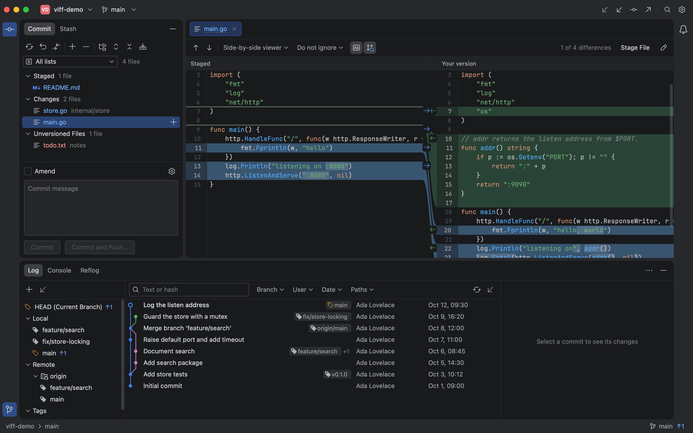
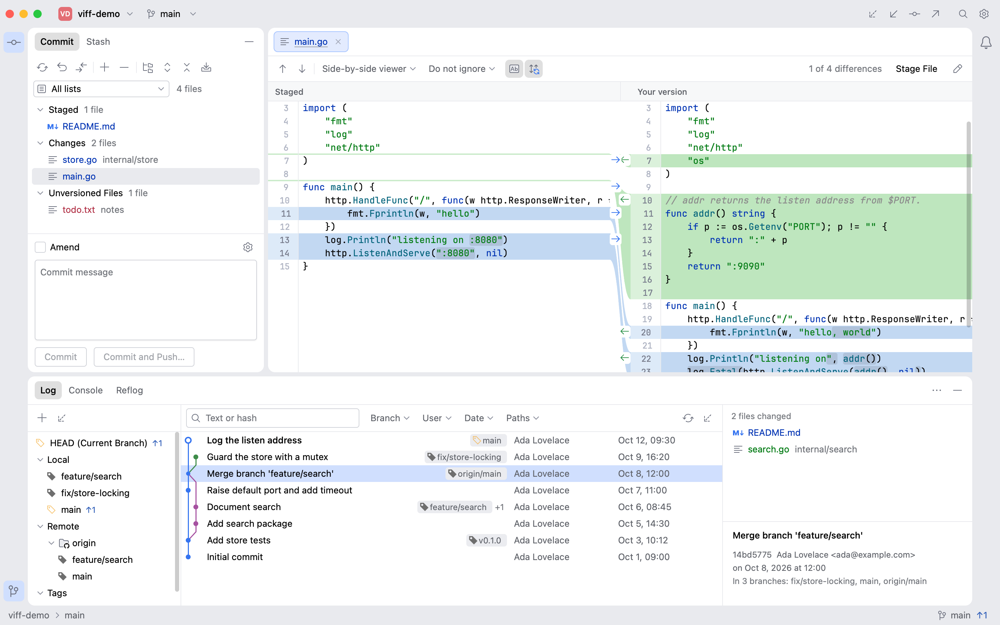

<div align="center">

# Viff

**A lightweight, native Git desktop client.**

Go + Viva. No Electron. No WebView. No bundled browser.

[English](README.md) · [简体中文](README.zh-CN.md)

[](https://github.com/1lck/viff/actions/workflows/ci.yml)
[](LICENSE)
[](https://go.dev/dl/)

[Get started](#get-started) · [Features](#a-full-git-workflow) · [Contribute](CONTRIBUTING.md) · [Releases](https://github.com/1lck/viff/releases)

</div>



## Keep the tool lightweight. Keep the workflow complete.

Viff puts your working tree, diffs, and history in one native desktop window.
It is written in Go with [Viva](https://github.com/vivaui/viva), renders without a
browser engine, and runs your installed Git executable.

- **A small distribution:** one application executable, plus license files. No separate browser runtime or local server to install.
- **A native desktop foundation:** Viva handles rendering and platform integration; Viff does not ship an Electron or WebView application.
- **Git stays Git:** use your repositories, remotes, hooks, and configured credentials. Inspect executed commands and output in the Console.
- **Work is loaded as needed:** paginated history and on-demand diffs keep large repositories from becoming a single eager load.

For a concrete size reference, stripped Go 1.27.3 builds on November 4, 2026
were **7.37 MiB on macOS arm64** and **7.65 MiB on Windows amd64**
(`-trimpath -ldflags="-s -w"`, executable only). Archive size, installed Git,
and runtime memory are separate measurements.

Lightweight is a design goal, not an unmeasured performance claim. Memory usage
and startup time vary with the repository, platform, and renderer; no comparative
RAM or startup benchmark is claimed.

## A full Git workflow

| Work                  | What Viff provides                                                                                                   |
| --------------------- | -------------------------------------------------------------------------------------------------------------------- |
| Review changes        | Side-by-side and unified diffs, syntax and word highlighting, search, synchronized scrolling, and multiple tabs      |
| Build a commit        | Stage files, hunks, or selected lines; unstage, roll back, amend, sign off, and commit/push                          |
| Organize work         | Multiple repositories, per-repository commit drafts, directory grouping, and named ChangeLists                       |
| Read history          | Commit graph, branch/author/path filters, multi-commit changed-file views, blame, reflog, and revision tree browsing |
| Manage branches       | Checkout, merge, rebase, cherry-pick, revert, reset, and stash-assisted checkout                                     |
| Resolve conflicts     | Ours / Result / Theirs views, per-block Ours/Theirs/Both actions, and explicit mark-as-resolved                      |
| Work across checkouts | Create worktrees from new or existing branches; manage submodules with dirty-work protection                         |
| Exchange changes      | Fetch, pull, push, force-with-lease, remotes, patches, and signing/credential settings                               |

**ChangeLists group files; they do not create separate Git indexes.** A commit
includes **all staged files**, even when a list filter is active. Filtered bulk
staging only stages visible files.

<details>
<summary>Light theme</summary>



</details>

Screenshots come from real Viva headless tests using disposable demo repositories.

## Get started

### Build from source

Install **Go 1.27.3 or newer** and **Git**. macOS also needs Xcode Command Line
Tools (`xcode-select --install`) because font registration and file watching use cgo.

```sh
git clone https://github.com/1lck/viff.git
cd viff
go build -trimpath -ldflags="-s -w" -o build/viff ./cmd/viff
./build/viff /path/to/repository
```

On Windows, run these commands in PowerShell after cloning:

```powershell
go build -trimpath -ldflags="-s -w" -o build/viff.exe ./cmd/viff
.\build\viff.exe C:\path\to\repository
```

Launch without a path to reopen the last project or show the welcome screen.
You can also open, clone, or initialize a repository there.

### Download a release

[GitHub Releases](https://github.com/1lck/viff/releases) provides available builds,
release notes, and SHA-256 checksums. Early releases are **pre-release,
unsigned executables**, not signed installers. Git must be installed separately.
Choose the archive matching your OS and CPU architecture.

## Platform status

| Platform | Verification                                                               |
| -------- | -------------------------------------------------------------------------- |
| macOS    | Native development and Git / headless UI tests                             |
| Windows  | Real Git and Viva headless UI tests on Windows Server 2022 x64; Windows CI |
| Linux    | Not yet validated as a desktop application                                 |

Windows 10/11 desktop interaction, IME input, installers, and signing still need
dedicated acceptance testing. Some shortcut labels still use macOS symbols.
Windows and Linux file watching uses polling.

The pre-publication acceptance suite covered **298 top-level tests**, including
**80 headless UI tests**, and captured **194 Windows screenshots**. These are
dated verification results, not a claim that every platform or edge case is covered.
See [testing and platform notes](docs/testing.md).

## Develop and test

```sh
go test ./...
go vet -tags "vivahead litheaudit" ./...
go test -tags "vivahead litheaudit" ./internal/ui
```

The UI suite runs **without opening application windows**. To keep screenshots:

```sh
VIFF_SHOTS="$PWD/.viff-test/shots" VIFF_SHOTS_BY_TEST=1 \
  go test -count=1 -tags "vivahead litheaudit" ./internal/ui
```

Tests create disposable repositories and use isolated Git configuration. CI runs
on macOS and Windows and retains test evidence as workflow artifacts.

- [Contributing / 参与贡献](CONTRIBUTING.md)
- [Security policy / 安全问题](SECURITY.md)
- [Detailed feature guide (中文)](docs/features.zh-CN.md)
- [Design (中文)](docs/design.md) and [architecture decisions](docs/decisions/README.md)

Settings live in your OS user configuration directory under `Viff/settings.json`.
The Settings dialog shows the actual path. Repository writes target the active
repository; inactive repositories refresh when requested. Free-form conflict
editing and unsupported binary conflicts use an external editor.

## License and credits

Viff's original code is [MIT licensed](LICENSE). Viva, JetBrains Mono, IntelliJ
Platform icons, and other dependencies retain their own licenses; see
[third-party notices](THIRD_PARTY_NOTICES.md).

The interface takes inspiration from IntelliJ IDEA's Git workflow. Viff is an
independent project and is not affiliated with or endorsed by JetBrains.
