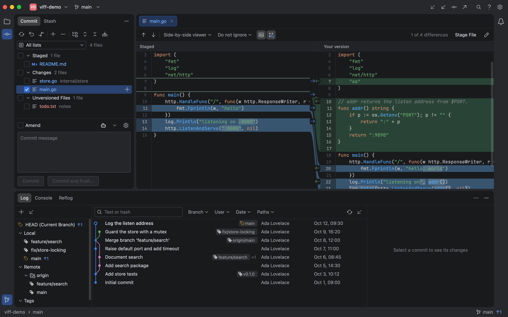
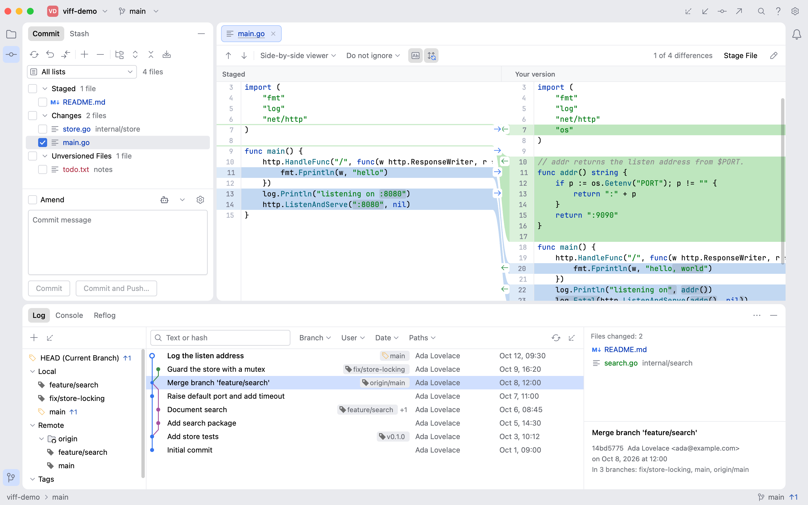
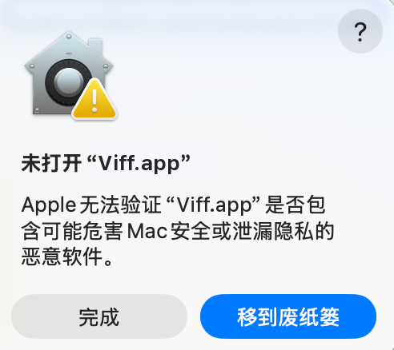
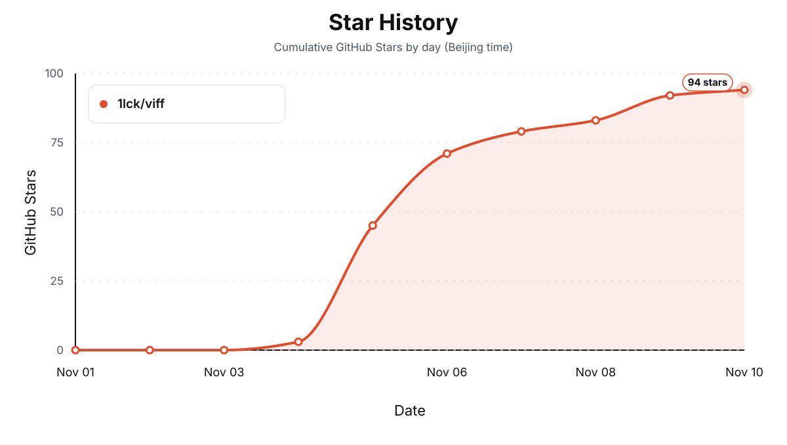

<div align="center">


# Viff

**轻量、原生的 Git 客户端，内置只读项目浏览、中英文界面与可选的 AI 提交说明。**

Go + Viva。无需 Electron，无需 WebView，不捆绑浏览器运行时。

[English](README.md) · [简体中文](README.zh-CN.md)

[](https://github.com/1lck/viff/actions/workflows/ci.yml)
[](LICENSE)
[](https://go.dev/dl/)

[功能](#轻量也能覆盖完整的-git-工作流) · [交流群](#加入交流群) · [参与贡献](CONTRIBUTING.md) · [下载](https://github.com/1lck/viff/releases)

</div>



## 让工具轻一点，让工作流完整一点

Git 仍是核心。围绕它，Viff 提供只读的项目浏览与 Quick Open、图片 diff、
中英双语界面，以及可选的 AI 提交说明。它使用 Go 和
[Viva](https://github.com/vivaui/viva) 编写，不依赖浏览器引擎绘制界面，
通过本机安装的 Git 执行操作。

- **分发轻量**：一个应用可执行文件，加上许可证文件，不需要安装独立浏览器运行时或本地服务。
- **原生桌面基础**：Viva 负责绘制与平台集成，Viff 不采用 Electron 或 WebView。
- **沿用你的 Git**：使用现有仓库、远端、钩子及凭据配置，在 Console 中查看实际执行的命令和输出。
- **按需加载**：历史分页读取，Diff 按需打开，避免启动时把大仓库的全部内容一次加载进来。

作为可复现的体积参考：2026 年 11 月 5 日从 v0.2.0 构建的可执行文件，
**macOS arm64 为 12.05 MiB，Windows amd64 为 13.61 MiB**
（`-trimpath -ldflags="-s -w"`，仅统计可执行文件）。压缩包大小、本机 Git 和运行内存不在这个数字内。

“轻量”是设计目标，不是未经测量的性能承诺。实际内存与启动耗时取决于仓库、平台和渲染环境，
目前不宣称具体内存占用，也不使用“比某产品快几倍”的对比数字。

## 加入交流群

欢迎加入 Viff 交流群，分享使用体验、提出问题，并获取最新动态。

<p align="center">
  
</p>

<p align="center"><sub>使用微信扫码加入交流群。群二维码会周期性过期，如无法加入，欢迎在 Issue 中告知，我们会更新。</sub></p>

## 轻量，也能覆盖完整的 Git 工作流

| 场景       | 功能                                                                                                                              |
| ---------- | --------------------------------------------------------------------------------------------------------------------------------- |
| 查看改动   | 并排 / 统一 Diff、语法与词级高亮、搜索、同步滚动、多页签、图片预览                                                                |
| 整理提交   | 按文件、目录或整组勾选后暂存，也可按块或选中行暂存；取消暂存、回滚、Amend、Sign-off、提交并推送；说明区可折叠，也可让模型生成说明 |
| 管理工作区 | 多仓库、各仓库独立提交草稿、目录分组、命名 ChangeList                                                                             |
| 阅读历史   | 提交图、分支 / 作者 / 路径筛选、多提交文件汇总、Blame、Reflog、历史仓库树                                                         |
| 浏览文件   | Project 面板（目录折叠、状态着色）、Quick Open、只读查看、Blame 与文件历史                                                        |
| 操作分支   | Checkout、Merge、Rebase、Cherry-pick、Revert、Reset、借助 Stash 切换分支                                                          |
| 撤销操作   | ⌘Z 撤销本会话内上一次本地提交、合并、rebase、检出或分支改动                                                                       |
| 解决冲突   | Ours / Result / Theirs 三栏，逐块接受 Ours / Theirs / Both，显式标记解决，可复制冲突上下文给外部 AI                               |
| 多工作目录 | 从新分支或已有分支创建 Worktree，管理子模块，保护未提交改动                                                                       |
| 大文件     | 检测 Git LFS 规则与受管文件；缺 git-lfs 时提示如何安装                                                                            |
| 同步协作   | Fetch、Pull、Push、force-with-lease、远端、补丁、签名与凭据设置                                                                   |
| 网页协作   | 在 GitHub、GitLab、Bitbucket 或 Gitea 打开提交、分支、比较与创建 PR 的页面                                                        |
| 执行命令   | 内置终端，在当前仓库打开；支持滚动回看、选择复制、粘贴、清屏、重启与缩放                                                           |
| 使用母语   | 界面支持英文与简体中文，默认英文，可在 设置 → General → Language 切换                                                             |

**界面默认英文，可在 设置 → General → Language 切到简体中文。**

**ChangeList 是文件分组，不是独立的 Git 索引。** 即使开启清单筛选，提交仍包含
**全部已暂存文件**；筛选后的批量暂存只处理可见文件。

**AI 生成提交说明是可选的，默认关闭。** 启用后会把变更文件、diff 以及你写的提交信息规则
（没有自定义时为内置规则）发送到你自己配置的端点，边界见[隐私说明](docs/privacy.md)。

**Copy for AI 只把冲突上下文复制到剪贴板**，交给外部工具；Viff 不调用模型、不发送任何内容。

<details>
<summary>查看浅色主题</summary>



</details>

截图来自真实 Viva 无头测试，使用可销毁的演示仓库。

## macOS 提示“无法打开 Viff.app”

如果 macOS 提示“Apple 无法验证 Viff.app 是否包含可能危害 Mac 安全或泄漏隐私的恶意软件”，
通常是因为手动下载的安装包尚未经过 Apple 公证。请先确认应用来自可信的
[GitHub Releases](https://github.com/1lck/viff/releases)，然后选择以下任一方式：

<p align="center">
  
</p>

1. 在“应用程序”中按住 Control 键点按 `Viff.app`，选择“打开”，再在确认对话框中选择“打开”。
2. 如果仍被阻止，打开“系统设置 > 隐私与安全性”，在安全性提示旁点按“仍要打开”，然后再次启动应用。
3. 也可以在终端中移除下载文件的隔离标记：

   ```bash
   sudo xattr -dr com.apple.quarantine /Applications/Viff.app
   ```

上述命令只应对你确认来源可靠的应用使用。

## ⭐ 特别鸣谢

<p align="center">
  <a href="https://linux.do/">
    
  </a>
</p>

<p align="center">
  <strong>关于 AI 的一切，欢迎前往 <a href="https://linux.do/">LINUX DO</a>！祝社区越来越好～</strong>
</p>

## 贡献者

感谢所有参与 Viff 开发和改进的贡献者。

<a href="https://github.com/1lck/viff/graphs/contributors">
  
</a>

## 许可与致谢

Viff 原创代码采用 [MIT 许可证](LICENSE)。Viva、JetBrains Mono、IntelliJ Platform 图标及其它依赖
保留各自许可，详见[第三方声明](THIRD_PARTY_NOTICES.md)。

界面参考了 IntelliJ IDEA 的 Git 工作流。Viff 是独立项目，与 JetBrains 没有关联，也未获得其背书。

## Star History

<a href="https://www.star-history.com/#1lck/viff&Date">
  
</a>
