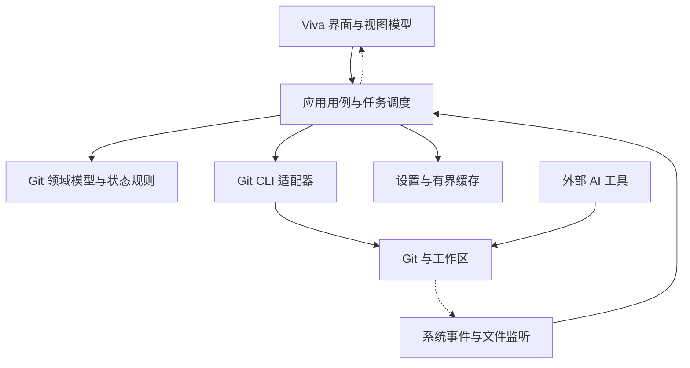

# Viff 产品与技术设计草案

版本：0.1；更新：2026-11-03；状态：待评审，未开始实现。

本文面向长期开发与维护者。已确认的需求是：完整 Git 桌面客户端、以 Rebased 为 UI 参照、低内存、跨平台；冲突只读展示，代码由用户的外部 AI 工具修改。以下架构、阶段和性能预算均为建议，不代表已验证能力或交付承诺。Viff 暂以当前目录名命名。

**长期维护优先于局部开发速度。** 业务状态不依赖 UI 框架，Git 是仓库事实来源，性能优化必须有可重复测量，依赖升级必须有回归依据。采用一个 Go 桌面进程、Viva 界面和按需 Git 子进程，不设常驻后端服务。

**功能边界。** “完整”指下列 Git 工作流，不等于覆盖 Git 所有命令或 IntelliJ 的所有能力。Rebased 基于 IntelliJ，其 README 描述了保留 Git 集成的定位；本项目需要重新实现对应体验，不能把平台能力当成现成组件。[Rebased 项目说明](https://github.com/DetachHead/rebased)

| 模块         | 目标范围                                                                                  | 交付阶段                    |
| ------------ | ----------------------------------------------------------------------------------------- | --------------------------- |
| 仓库管理     | 打开、初始化、克隆、最近仓库、多仓库切换、识别 worktree                                   | P1；worktree 管理已实现（0012） |
| 历史查看     | 提交图、分支与标签标记、作者/日期/路径/消息筛选、提交详情、提交与分支比较                 | P1                          |
| 文件查看     | 文件历史、指定版本内容、blame、复制路径/提交 ID、在外部打开                               | P1；blame 已实现（0007）    |
| Diff         | 双栏/统一视图、行内差异、语法高亮、上下文展开、同步滚动、搜索与复制、空白差异选项         | P1                          |
| 特殊差异     | 重命名、文件模式、符号链接、二进制说明、图片对比与超大文件受限预览                        | 基础识别 P1；图片 P3        |
| 工作区与提交 | 未跟踪/已修改/已暂存列表；文件、块、行级暂存与取消暂存；commit、amend、丢弃修改、补丁创建与应用 | P1；行级 P2                 |
| 分支与标签   | 创建、切换、重命名、删除分支；上游设置；创建、查看、删除标签                              | P1                          |
| 远程         | remote 管理、fetch/prune、pull 的 merge/rebase 选择、push、推送标签、受保护的强制推送入口 | P1；高级选项 P2             |
| 历史操作     | merge、rebase、交互式 rebase 的重排/squash/fixup/reword/drop、cherry-pick、revert、reset  | P2                          |
| 暂存与恢复   | stash 创建/查看/apply/pop/drop、reflog 查看与从历史位置创建恢复分支                       | P2                          |
| 冲突         | 仓库提示、文件分类、文本冲突块定位、双方版本和当前文件只读查看、外部修改刷新              | P1 识别；P2 完整流程        |
| 操作状态     | 进度、错误与输出摘要、取消适用任务、continue/skip/abort 的按状态入口、重启后恢复展示      | 各操作同步交付              |
| 扩展仓库     | worktree 创建/删除/切换；submodule 状态、更新与同步；LFS 状态与依赖缺失提示             | worktree 已实现（0012）；submodule 已实现（0010）；LFS P3 |
| 桌面设置     | 深浅主题、字体/缩放、快捷键、面板比例、Git 路径、外部工具、可配置自动 fetch               | P1 基础；逐步补全           |
| Git 兼容     | 继承用户 Git 配置、credential helper、SSH agent、hooks 和签名工具，显示失败与交互等待     | P1 基础；发布前完成兼容矩阵 |

P3 仍属于目标范围，不能在未交付时宣称已完整支持。第一版不做 IDE、通用代码编辑、语言服务、全项目代码索引、插件市场、内置 AI、托管平台 PR/Issue 工作台。提交消息和 rebase 计划的编辑属于 Git 操作。应用内不提供冲突结果编辑、自动 AI 修复或左右版本接受按钮。

**冲突展示必须忠实于 Git 状态。**

1. 用 Git 未合并索引和操作状态确定冲突文件，不能只搜索 `<<<<<<<`。索引可能保存 base、stage 2、stage 3 的版本，某些冲突缺少其中一个版本。[Git 索引文档](https://git-scm.com/docs/git-ls-files)
2. 对包含冲突标记的文本，解析 merge/diff3/zdiff3 常见格式及标记宽度，提供块导航、上下文、行号与双方内容。不能可靠识别时退回文件级说明，不编造冲突行号。
3. 修改/删除、添加/添加、重命名及二进制冲突使用对应说明。界面显示实际来源分支/提交；rebase 场景不把 ours/theirs 固定解释为“我的/对方的”。
4. 外部 AI 修改后自动刷新；无冲突标记但仍未合并时显示“内容已更新，尚未暂存”。暂存只说明 Git 状态已改变，不宣称代码逻辑正确。
5. 用户或 AI 完成暂存后，重新查询是否还有未合并项，并按当前操作提供继续/跳过/中止入口。AI 也可能完成整个操作，界面必须跟随真实状态退出冲突模式。
6. 提供复制文件路径、行号及冲突内容的轻量入口。无需接入特定 AI 服务即可完成工作流。

**架构让业务可以独立测试，让 Viva 保持在界面边界内。**

图中的箭头表示运行时调用或数据通知；源码依赖由应用层定义的小接口约束，具体适配器在启动入口组装。初期使用单 Go module 和模块化单体，不创建微服务、通用消息总线或自研组件框架。

| 建议目录            | 职责                                           | 依赖约束                       |
| ------------------- | ---------------------------------------------- | ------------------------------ |
| `cmd/viff`          | 启动、依赖组装、退出与资源回收                 | 不承载 Git 业务规则            |
| `internal/domain`   | 仓库身份、引用、提交、差异、冲突、操作状态     | 不导入 Viva，不启动进程        |
| `internal/app`      | 用例、查询、命令、调度、状态版本、缓存失效     | 通过窄接口访问外部资源         |
| `internal/gitcli`   | 参数构造、机器输出解析、进程生命周期、能力检测 | 不返回 UI 节点，不直接更新 UI  |
| `internal/ui`       | Viva 视图、视图模型、主题、可复用交互组件      | 不拼接 Git 命令，不读取 `.git` |
| `internal/platform` | 平台文件事件、外部打开、路径、窗口集成         | OS 差异集中于平台文件          |
| `internal/storage`  | 设置、迁移、缓存和日志配额                     | 不保存另一份权威 Git 状态      |
| `testdata`          | 小型确定性仓库生成输入、视觉场景               | 不提交大仓库与用户数据         |

这些是实现时的目录建议，本次只创建文档。接口围绕实际用例划分，避免一个覆盖所有 Git 命令的巨型接口，也不为每个结构体创建接口。领域层保留可测试的状态规则即可，不建设泛化的领域框架。

**官方 Git CLI 是首选执行引擎。** 这样可以沿用用户的认证、签名和 hooks 环境；仍需逐项验证 GUI 启动环境与终端的差异。第一阶段发现并允许配置系统 Git，记录版本和能力；最低支持版本在兼容测试后固定。是否随安装包分发 Git 单独决策，不能宣称当前架构无需外部依赖。

- 状态优先采用 `status --porcelain=v2 -z` 等机器格式；路径按 NUL 分隔，保留原始路径，显示转义不能反过来修改操作路径。[Git status 文档](https://git-scm.com/docs/git-status)
- 用参数数组执行进程，避免 shell 拼接。支持空格、换行、Unicode、特殊前缀路径及不同换行符；对象 ID 不写死为 SHA-1 长度。
- 输出流式解析，stderr 持续消费且限量保留。只在重复读取对象有测量收益时使用受管理的 `cat-file` 批处理进程，仓库休眠后退出。
- 读取任务可取消并丢弃过期结果；写操作的取消不等于撤销。中止进程后必须重新查询 Git 状态，明确是否需要 continue/abort，不能自动重试 commit/push 等写操作。
- 每个工作区的写操作串行；修改共享引用的操作按 common Git directory 协调。多个 worktree 既有独立状态也有共享数据。[Git worktree 文档](https://git-scm.com/docs/git-worktree)
- 应用内队列无法锁住外部 AI。执行暂存块、丢弃修改或历史操作前重新校验 HEAD、index 与涉及内容；发现变化就刷新并要求重新选择，不使用旧 patch 强行覆盖。
- 身份认证、hooks、签名和 rebase 编辑器需求由专用适配处理；显示等待和错误。凭据交给系统/helper，日志不记录令牌。不要静默禁用 hooks 或签名以换取“成功”。

**外部修改是常态，刷新机制是核心能力。** 查询返回带仓库身份和递增代次的快照；切仓库、切提交或文件变化后，旧代次结果不得覆盖新视图。仓库快照分片更新，避免每次刷新复制全量历史。

文件事件用于标记失效，经合并去抖后刷新相关状态；不因每个事件全量扫描。监听需覆盖实际 git dir、common dir 和相关工作区，不能假设 `.git` 一定是目录。分支切换产生的事件风暴合并为一次刷新。事件丢失、溢出、重新聚焦和任务结束均触发校验；平台监听不可靠时使用低频、有界的回退检查。非活动仓库暂停重任务，显示状态更新时间。

**低内存来自受控的数据生命周期。** Viva 的原生 GPU 后端与事件驱动重绘有利于降低基础开销，但 Go 自身仍有运行时和 GC，GPU/字体/原生桥接也消耗内存。不能把“没有浏览器运行时”换算成产品内存保证。[Viva README](https://github.com/vivaui/viva)

| 资源            | 设计策略                                                      | 防止的长期问题                    |
| --------------- | ------------------------------------------------------------- | --------------------------------- |
| 提交历史        | 分批获取元数据；详情按选中加载；长历史的页可落盘并淘汰        | 浏览越久占用越高                  |
| 提交图          | 只绘制可见行与预取区域；保存分页边界的图布局状态              | 跨页连线断裂、每次滚动重算全图    |
| 文件树与列表    | 可见区虚拟化、按需展开、稳定节点 ID                           | 十万文件创建十万 UI 节点          |
| Diff            | 按文件加载；文本、行索引和 token 分层；按内容身份共享只读数据 | 原始输出、字符串、UI 行各复制一份 |
| 高亮            | 可见区域计算；多行词法状态保存检查点                          | 滚动每次从文件开头扫描            |
| 超大文件/超长行 | 先检测，按阈值进入受限预览；展开需显式操作                    | 单个压缩文件或生成文件耗尽内存    |
| 缓存            | 按估算字节数设置全局与仓库配额；LRU 淘汰；可重建              | 每仓库限额相加失控                |
| 后台任务        | 有界队列、并发上限、背压、过期取消                            | 快速点选堆积 goroutine 和进程     |
| GPU 与字体      | 复用可见资源，限制纹理缓存，缩放/关窗时释放失效资源           | Go 堆稳定但原生内存持续增长       |
| 多仓库          | 非活动仓库只保留导航摘要，昂贵内容淘汰                        | 每打开一个仓库永久增加基线        |

Git 遍历历史仍可能耗时；UI 虚拟化不代表查询免费。避免深页重复大偏移扫描；持续遍历、索引或落盘策略应由真实仓库基准决定，不能默认常驻完整历史。大 diff 的限制须同时作用于 Git 输出和 UI，不能生成完整巨量结果后才截断。

优先减少重复数据和热路径分配，不预先大量使用对象池、unsafe、自定义分配器。通过 profile 证明热点后再优化，并记录收益与代价。不要将过低的 `GOMEMLIMIT` 作为“低内存模式”；它是 Go 运行时软限制，不覆盖原生资源和 Git 子进程，设置不当会增加 GC 压力。[Go GC 指南](https://go.dev/doc/gc-guide)

**性能验收先固定场景，再固定预算。** 以下仅为 P0 的预算候选，尚未测量；应记录达标或不达标，而非为了发布随意改阈值。

| 场景                | 初始候选目标                                           | 测量约束                                  |
| ------------------- | ------------------------------------------------------ | ----------------------------------------- |
| 单窗口启动并稳定    | 主进程常驻内存 ≤ 80 MiB                                | 固定 OS、分辨率、缩放与主题               |
| 常规仓库浏览和 diff | 主进程稳定占用 ≤ 150 MiB                               | 固定仓库及操作序列，分别测冷热缓存        |
| 大仓库受限浏览      | 主进程稳定占用 ≤ 300 MiB                               | 固定十万提交/大量变更样本，不包含无限展开 |
| 持续切换与关闭      | 占用回到基线附近，无持续增长趋势                       | 重复 100 次并记录稳定后的曲线             |
| 交互                | 滚动以 60 Hz 流畅呈现为目标；本地交互反馈 p95 < 100 ms | 数据未就绪也先响应选择和加载状态          |
| 空闲                | 无持续渲染循环和高频仓库轮询                           | 分别测前台、失焦、最小化及自动 fetch      |

各平台分别记录其常驻/私有/物理占用指标，不能直接混比不同口径。报告同时列出主进程、Git 与认证等子进程峰值、GPU/原生资源、Go 堆、CPU 和唤醒次数；注明共享内存避免重复加总。clone/fetch/大型 merge 的 Git 内存峰值单独验收，不能藏在主进程指标之外。先测 Viva 空窗口及 Rebased 同场景，发现基础开销超预算时公开调整设计或预算依据。

**跨平台意味着共享业务逻辑和分平台验收。** 调研时 Viva README 标注 Windows/Linux 后端为实验性；其一致性文档列明原生 Wayland、部分输入与真机验证缺口。文档不同章节也可能更新不同步，选定版本后需以对应源码和测试确认能力。[Viva 平台一致性说明](https://github.com/vivaui/viva/blob/main/docs/conformance.md)

| 平台    | 当前框架路线                                            | 本项目必须验证                                                       |
| ------- | ------------------------------------------------------- | -------------------------------------------------------------------- |
| macOS   | Cocoa、Metal、CoreText；桥接涉及 cgo                    | Apple Silicon 优先；签名、公证、输入法、Retina、多屏；Intel 单独验收 |
| Windows | Win32、D3D11、DirectWrite                               | Windows 11 x64 优先；125%/150% 缩放、IME、凭据、长路径、GUI 启动环境 |
| Linux   | XCB/X11、Vulkan、Pango/Cairo；Wayland 会话依赖 XWayland | 先明确发行版与桌面组合；字体、剪贴板、驱动依赖、缩放、事件监听       |

上述优先级是建议，不是放弃三端。每个功能进入主线即要求三端编译和相应逻辑测试，发布前跑真实桌面核心路径；模拟器、软件渲染和无头截图不能证明真实 GPU 流畅度。按 OS/架构独立打包，不承诺一份二进制通吃。发布矩阵需要记录最低系统版本、Git 版本、必要系统库、已验证架构和已知限制。

**UI 高还原依赖自有设计规格和少数专用组件。** Viva 默认组件风格不是 Rebased 风格。将颜色、字体、字号、行高、边框、间距、图标尺寸和状态颜色定义为集中 token；业务视图只组合组件，不散落 magic number。

优先建设提交图、虚拟文件列表、只读 diff、冲突块、可拖动分隔面板和一致的菜单/对话框。提交图与 diff 的数据布局算法独立于 Viva 绘制；不要实现通用代码编辑器。文本选择、键盘导航、搜索、复制、焦点和可访问性必须与视觉同时完成。

第一份视觉基准锁定 Rebased release/commit、操作系统、字体、主题、窗口尺寸和缩放。基准素材同时覆盖 hover、选中、禁用、加载、空状态、错误、弹窗、长文本和冲突，不能只有一张主页截图。截图以相同测试仓库生成，隐藏动态时间等噪声。

同平台用叠图和差分验收布局与状态，先对齐主界面、提交区和 diff。跨平台分别建立基准，字体需检查授权并统一字体度量策略；即使同字体，各平台文本栅格化仍可能不同。Viva 自身也区分几何一致与平台文字差异，因此不承诺三端每个文字像素完全相同。[Viva 视觉一致性说明](https://github.com/vivaui/viva/blob/main/docs/conformance.md#visual-parity)

**Viva 可以替换，但不为替换重写一个 UI 框架。** 仅在应用用例、视图模型和专用绘制输入边界做隔离，不复制 Viva 全部 API。Viva 类型不得进入 domain/app/gitcli。升级集中修改 UI 适配和组件，业务测试不应跟着框架 API 改动。

固定 Go、Viva 及主要依赖版本；升级独立提交，附三端构建、截图差异、内存/交互基准与回退方式。框架缺口优先最小复现、上游反馈和贡献。确需临时 fork 时，记录上游版本、补丁列表、移除条件和维护负责人，不长期保留无法解释的补丁堆。若 P0 证明关键文本能力或平台稳定性无法达标，提交替换 UI 的决策记录，保留业务层和测试资产。

**长期维护必须落到每次变更的交付条件。**

| 领域     | 维护规则                                                                                                          |
| -------- | ----------------------------------------------------------------------------------------------------------------- |
| 架构决策 | 在 `docs/decisions` 按编号记录背景、替代项、决定、代价与复审条件；旧决策标记被替代，不抹掉历史                    |
| 需求追踪 | 为实现中的功能分配稳定 ID，关联用例、错误场景、测试与阶段；文档中的未实现能力不能写成已支持                       |
| 测试资产 | 临时真实 Git 仓库覆盖 merge/rebase、并发外部修改、重命名、删除、非 ASCII 路径、worktree；仅 mock 不足以证明正确性 |
| UI 回归  | 布局快照和行为测试结合；golden 更新需解释差异，不机械接受截图变化                                                 |
| 状态恢复 | 重启后从 Git 重建操作状态；操作日志用于诊断，不自动重放未确认的写命令                                             |
| 设置演进 | schema version、逐版本迁移、原子写入；迁移前备份；旧版遇新格式有明确提示，禁止静默覆盖                            |
| 缓存演进 | 版本化、限额、可删除重建；损坏不能阻止打开仓库；初期不引入数据库，必要时另做存储决策                              |
| 错误模型 | 区分用户取消、认证、仓库变更、锁占用、不支持能力和 Git 失败；保留诊断上下文与可操作提示                           |
| 可观测性 | 有界日志，记录任务时长、取消和缓存命中；诊断导出脱敏；不默认上传代码、路径或 Git 输出                             |
| 发布维护 | changelog、兼容矩阵、打包冒烟、配置迁移测试、上一稳定包与回退说明；自动更新另立设计                               |
| 技术债   | 每项记录原因、影响、负责人/角色、复审阶段；不将临时 workaround 作为无期限默认实现                                 |

写操作测试还需验证操作后的 HEAD、index、工作区和恢复路径。reset、丢弃修改、删除分支、强推等在产品界面显示具体作用对象与后果；不提供虚假的统一“撤销”。强推默认考虑 lease 保护，恢复入口基于可用 reflog/引用，不能声称所有修改可恢复。

每个阶段要求：正常流程与失败/中断流程可用；UI 与 Git 状态一致；三端验证级别有记录；性能和视觉变化有解释；文档和决策同步。对改变仓库的功能先验证状态正确性，再做性能优化。

**分阶段推进，每阶段都保留可维护的完整路径。**

| 阶段              | 交付内容                                                                         | 进入下一阶段的依据                                                    |
| ----------------- | -------------------------------------------------------------------------------- | --------------------------------------------------------------------- |
| P0 架构验证       | 固定视觉参照；Viva 三端窗口；真实历史图与 diff；只读冲突；外部修改刷新；性能基线 | 选择/复制/滚动/缩放可靠；业务层无 Viva 依赖；明确支持矩阵与预算可行性 |
| P1 日常客户端     | 打开/clone、查看、暂存/提交、分支、基础远程与状态提示                            | 能完成真实日常流程；凭据/hooks 失败可诊断；不会覆盖 AI 新修改         |
| P2 完整历史工作流 | 行级暂存、stash、rebase/cherry-pick/revert/reset、reflog、冲突后继续/中止        | 失败、重启和外部工具接管均有真实仓库回归                              |
| P3 扩展与发布打磨 | LFS、图片差异、完整设置、打包与平台细节                                         | 支持矩阵逐项验收；长时资源稳定；迁移和升级可回退                      |

P0 不是可丢弃的巨型 demo：界面、Git 适配、调度从第一条路径就按上述边界组织，但只实现当前需要的最小模块。后续每个阶段持续补齐同一套架构，避免“先堆出来，以后整体重写”。

**实施前仍需固化的选择。** Rebased 视觉基准版本与字体；Viva 固定版本和三端支持矩阵；Git 最低版本与分发方式；性能基准仓库与硬件；应用图标与安装包身份。这些由 P0 的调研和实测形成决策记录，不能凭本文直接视为已经验证。
